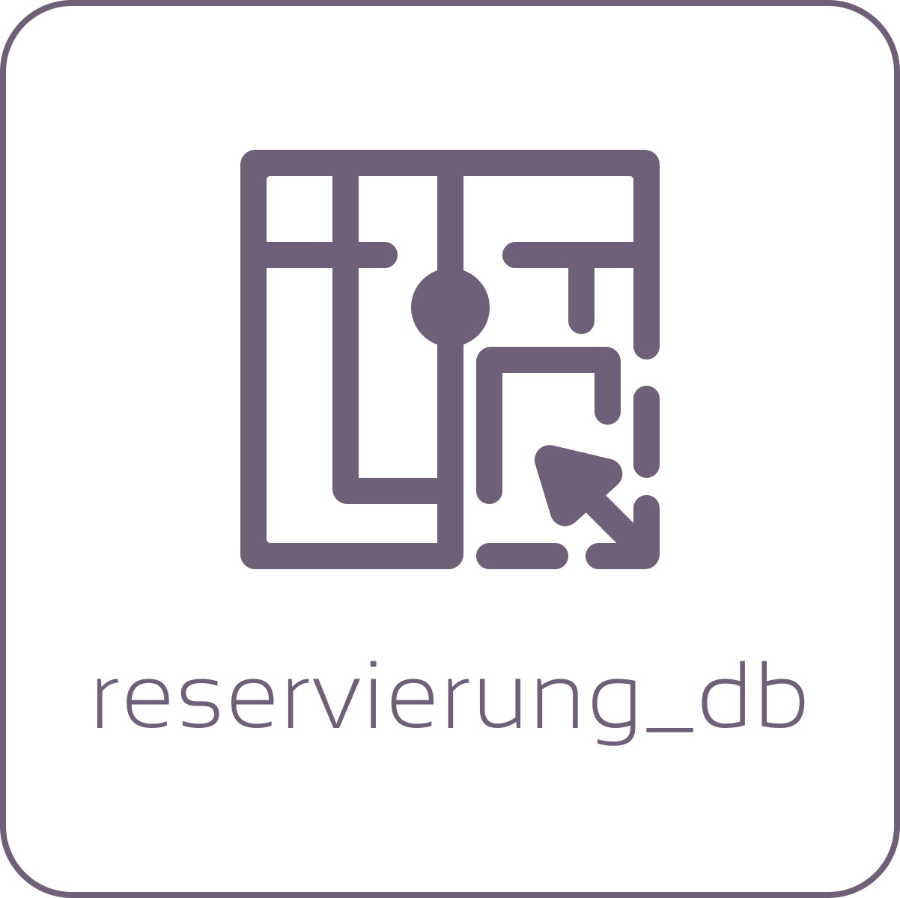

  

# SQL Reservierungssystem
> A robust relational database system designed for managing equipment rental processes, customers, and bookings.

## License

This project is licensed under the **GNU Affero General Public License v3.0 (AGPL-3.0)**.

I chose this license to ensure that this work remains open-source and free for the community.
If you use, modify, or distribute this code, including as a web service, you must:
1. Provide the same rights to others (Copyleft).
2. Disclose the source code.
3. Keep the original copyright notice.
4. If you run this software as a network service, you must make the source code available
   to the users of that service.

See the [LICENSE](LICENSE) file for the full legal text.

## Official documentation

This file is intended as a small summary of the whole documentation on the start page. You don't need to download dependencies like AsciiDoctor, because I will provide HTML versions of everything.

Consult the following link:

* [Official Documentation](https://mtdeve.github.io/reservierung_db/) to find out **how to run** it and all details of the project.

## Author
Feel free to contact me if you have any questions regarding this database schema!

**mtdeve**
* [GitHub Profile](https://github.com/mtdeve)
* [Email](mailto:mirkotardio@web.de)

## 💖 Support the Project

If you find this project useful and would like to support its ongoing development, consider becoming a sponsor! Your support helps cover development time, maintenance, and new features.

